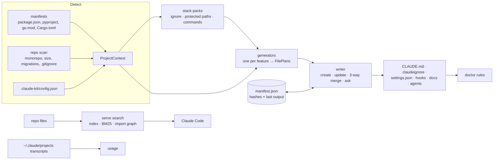

# claude-kit

Make any repo cheap and effective to work on with Claude Code. claude-kit looks at your project and generates the files that make Claude Code cheaper and safer to run there: a lean `CLAUDE.md`, enforced read exclusions, edit guardrails, context snapshots, subagents and a token-budget status line. It then audits the setup (`doctor`) and measures how real sessions go (`usage`).

```bash
npx claude-kit init          # or: bunx claude-kit init
```

It ships as one package for macOS, Linux and Windows: plain JavaScript (~0.5 MB, no dependencies to install) that runs on Node 20+ or Bun.

- [Why](#why)
- [Quick start](#quick-start)
- [Everyday workflow](#everyday-workflow)
- [What gets generated](#what-gets-generated)
- [Guardrails](#guardrails)
- [Commands](#commands)
- [Configuration](#configuration)
- [How it works](#how-it-works)
- [Development](#development)

## Why

Each Claude Code session pays for everything it loads: memory files, tool definitions, every file it reads, every turn of history. Most of that cost comes from defaults nobody chose:

- Claude reads build output and lockfiles.
- CLAUDE.md files grow past their useful size.
- Edits to the prompt prefix break the prompt cache mid-session.
- Task state is lost at compaction.
- Claude edits files that should never be hand-edited.

claude-kit sets each of those defaults on purpose, from what is actually in your repo. Because the files it writes are ordinary Claude Code files, the setup keeps working without claude-kit installed.

## Quick start

```bash
cd your-project
npx claude-kit init                    # interactive: pick a preset
npx claude-kit init --preset standard  # or skip the questions
npx claude-kit doctor                  # check the result: score + findings
```

Then commit what it generated (including `.claude-kit/manifest.json`) and start Claude Code as usual. Nothing else needs to run: the hooks and settings are picked up by Claude Code itself.

Pick a preset by how much you want:

| Preset              | For                     | Adds                                                                                          |
| ------------------- | ----------------------- | --------------------------------------------------------------------------------------------- |
| `minimal` (default) | Any repo, zero overhead | `.claudeignore` + enforced deny rules, lean `CLAUDE.md`, edit-guard hook                      |
| `standard`          | Day-to-day team use     | + task context & snapshots across compaction, context guard, team memory, `docs/`, `opusplan` |
| `full`              | Big repos, heavy users  | + subagents, token-budget status line, codebase map, `compress` pointer                       |

Fine-tune with `--with` / `--without`, e.g. `init --preset standard --with agents --without docs`. The features are `claudeignore claudemd hooks snapshots memory docs models agents budget compress rag`, plus `search` (the [code-search MCP server](#search-code-search-for-claude)), which no preset includes because it adds a server to every session.

### With Bun

```bash
bunx claude-kit init               # no install; works even without Node
bun add -d claude-kit              # per project, then: bun run claude-kit doctor
bun add -g claude-kit              # global command; needs Node on PATH
```

The global `claude-kit` command is a `#!/usr/bin/env node` script, the only kind npm can wire up on Windows. On a Bun-only machine, use `bunx claude-kit` instead, or alias it: `alias claude-kit="bunx claude-kit"`.

## Everyday workflow

| When                                            | Run                                                                      | Why                                                                 |
| ----------------------------------------------- | ------------------------------------------------------------------------ | ------------------------------------------------------------------- |
| Once per repo                                   | `claude-kit init`                                                        | Generate the setup                                                  |
| After editing `.claudeignore` or the config     | `claude-kit sync`                                                        | Recompile deny rules and hooks from your edits                      |
| After adding a dependency like Django or Prisma | `claude-kit sync`                                                        | Picks up new migration folders and commands                         |
| In CI, on every PR                              | `claude-kit doctor --check`                                              | Catch a bloated CLAUDE.md or a cache-breaking edit before it merges |
| Every week or two                               | `claude-kit usage`                                                       | See what sessions really cost and what broke the cache              |
| Before/after trimming memory files              | `claude-kit context --json > before.json`, then `--baseline before.json` | Measure the saving                                                  |
| After upgrading claude-kit                      | `npx claude-kit@latest upgrade`                                          | Apply newer templates without losing your edits                     |

Inside a session, Claude itself follows the habits written into `CLAUDE.md`:

- plan first for multi-file changes
- keep `.claude/context/task_context.md` current
- delegate searches to the `explorer` agent
- skim big files with `claude-kit compress --outline`

## What gets generated

### `minimal`

| File                         | Purpose                                                                                                                                           |
| ---------------------------- | ------------------------------------------------------------------------------------------------------------------------------------------------- |
| `.claudeignore`              | Paths Claude shouldn't read: build output, caches, lockfiles, secrets, plus your `.gitignore`.                                                    |
| `.claude/settings.json`      | `permissions.deny` `Read(...)` rules compiled from `.claudeignore` (Claude Code doesn't read `.claudeignore` itself), plus the hook registration. |
| `CLAUDE.md`                  | Short skeleton: stack, commands, workflow habits, guardrails. Filled in from your manifests.                                                      |
| `.claude/hooks/pre-edit.cjs` | `PreToolUse` hook enforcing the [guardrails](#guardrails): protected paths, committed migrations, opt-in content rules.                           |
| `.claude-kit/manifest.json`  | What claude-kit generated, so re-runs never clobber your edits. Commit it.                                                                        |

### `standard` adds

| File                                     | Purpose                                                                                                                                                                                                                                                                                           |
| ---------------------------------------- | ------------------------------------------------------------------------------------------------------------------------------------------------------------------------------------------------------------------------------------------------------------------------------------------------- |
| `.claude/context/task_context.md`        | Current task state Claude keeps up to date; re-injected after compaction by a `SessionStart` hook.                                                                                                                                                                                                |
| `.claude/hooks/context-snapshot.cjs`     | Saves each compaction summary to `.claude/context/snapshots/` (git-ignored, last 10 kept).                                                                                                                                                                                                        |
| `.claude/hooks/context-guard.cjs`        | `UserPromptSubmit` hook. At 60% of the context window (or `CLAUDE_KIT_COMPACT_AT` tokens) it asks Claude to update `task_context.md`; at 80% it asks again and suggests `/compact`. Each level fires once. Every 10 prompts it also asks Claude to log new decisions in `conversation_memory.md`. |
| `.claude/context/conversation_memory.md` | Team-shared decisions and lessons. Claude reads it on demand; it is never `@imported`, so it can't break caching.                                                                                                                                                                                 |
| `docs/`                                  | `architecture.md` (pre-filled from the repo layout), `api-contracts.md`, `data-models.md`, `debugging.md`. Created once; after that they're yours.                                                                                                                                                |
| `"model": "opusplan"`                    | Opus in Plan Mode, Sonnet for execution. The cheatsheet sits in a CLAUDE.md HTML comment, which costs no tokens.                                                                                                                                                                                  |

### `full` adds

| File                                       | Purpose                                                                                                                                                                                    |
| ------------------------------------------ | ------------------------------------------------------------------------------------------------------------------------------------------------------------------------------------------ |
| `.claude/agents/`                          | `explorer` (Haiku, read-only search), `reviewer`, `test-writer`. Only their descriptions cost main-context tokens.                                                                         |
| `.claude/statusline/token-budget.cjs`      | Status line showing context %, prompt-cache hit ratio and cost, with an optional `CLAUDE_KIT_BUDGET_USD` limit. It also gives the context guard the exact window size.                     |
| `docs/INDEX.md`                            | Only for repos over ~200K tokens: a regenerated map of areas and largest files.                                                                                                            |
| CLAUDE.md pointer to `claude-kit compress` | So Claude outlines big files instead of reading them whole.                                                                                                                                |
| `.claude/skills/compress-doc/`             | Skill for long documents: outline first, then `--extract`, and `--summarize` only after asking you, because it sends the file to the API. Only its description loads until Claude uses it. |

### `--with search` adds

| File                                  | Purpose                                                                                            |
| ------------------------------------- | -------------------------------------------------------------------------------------------------- |
| `.mcp.json` entry `code-search`       | Runs `npx claude-kit@<version> serve search` (or `bunx`). The pinned version moves with `upgrade`. |
| `"enabledMcpjsonServers"` in settings | Pre-approves the server, so the team isn't asked on first use.                                     |
| CLAUDE.md "Code search" section       | Tells Claude to call `search_code` before grepping, and `related_files` before changing a file.    |
| `.claude-kit/index/`                  | Built on first use, updated incrementally, git-ignored and listed in `.claudeignore`.              |

Supported stacks: Node/Bun (npm, pnpm, yarn, bun), Python (uv, poetry, pipenv, pip), Go and Rust, including their monorepo setups. Other stacks can be added through [stack packs](#stack-packs).

## Guardrails

Claude Code runs the generated `pre-edit.cjs` before every Edit, Write, MultiEdit and NotebookEdit. When an edit is blocked, the hook exits with code 2 and tells Claude why, so Claude changes the right thing instead of retrying. The hook fails open on input it doesn't understand, and it never blocks paths outside the project.

**1. Protected paths (always on).** Lockfiles, build output, `node_modules/`, `.venv/`, `.git/` and `.env*` are blocked; `.env.example` is allowed. Each stack pack adds its own patterns.

**2. Committed migrations (on when detected).** Database migrations that other environments have already run are history. claude-kit finds them by dependency or by their folder on disk, so packages inside a monorepo are covered too:

| Tool                    | Protected                                         | Claude is told to run                                    |
| ----------------------- | ------------------------------------------------- | -------------------------------------------------------- |
| Django                  | `**/migrations/*.py`                              | `python manage.py makemigrations`                        |
| Alembic / Flask-Migrate | `**/alembic/versions/`, `**/migrations/versions/` | `alembic revision --autogenerate`                        |
| Prisma                  | `**/prisma/migrations/`                           | `prisma migrate dev --name …`                            |
| Drizzle                 | the folder holding `meta/_journal.json`           | `drizzle-kit generate`                                   |
| Knex, Sequelize         | `**/migrations/`                                  | `knex migrate:make` / `sequelize-cli migration:generate` |
| Diesel, SQLx            | `**/migrations/`                                  | `diesel migration generate` / `sqlx migrate add`         |
| goose, golang-migrate   | `**/migrations/`                                  | `goose create` / `migrate create`                        |
| Rails, Flyway           | `db/migrate/`, `**/db/migration/`                 | `bin/rails generate migration` / a new `V<n>__` file     |

Only files git already tracks are blocked, so Claude can still write and fix a new migration before you commit it. Without git, any existing migration file counts as committed. To turn this off, set `"guardrails": { "migrations": false }`.

**3. Content rules (opt in).** These check the code an edit adds. Only new matches count: an edit that leaves an existing `console.log` in place still passes.

| Built-in id             | Blocks                                                            | Skips                                               |
| ----------------------- | ----------------------------------------------------------------- | --------------------------------------------------- |
| `no-console-log`        | `console.log(` in JS/TS                                           | tests, `scripts/`, `*.config.*`                     |
| `no-debugger`           | `debugger` statements                                             |                                                     |
| `no-focused-tests`      | `it.only(` / `test.only(` / `describe.only(`                      |                                                     |
| `no-print`              | `print(` in Python                                                | tests, `conftest.py`, `scripts/`                    |
| `no-breakpoint`         | `breakpoint()`, `pdb.set_trace()`                                 |                                                     |
| `no-raw-db`             | `db.query(` / `db.exec(` / `db.execute(` / `db.raw(`              | `repositories/`, `*repository.*`, tests, migrations |
| `py-return-annotations` | a Python `def` without `->`                                       | tests                                               |
| `requires-test`         | a new exported JS/TS function or class with no test file          | tests, `*.d.ts`, `index.*`                          |
| `requires-test-py`      | a new public top-level Python function or class with no test file | tests, `__init__.py`                                |
| `requires-test-go`      | a new exported Go function with no `_test.go` file                |                                                     |

```json
{
  "guardrails": {
    "content": [
      "no-console-log",
      { "extends": "no-print", "exclude": ["cli/", "tests/"] },
      {
        "id": "no-any",
        "files": ["src/**/*.ts"],
        "exclude": ["*.d.ts"],
        "pattern": ":\\s*any\\b",
        "reason": "use unknown and narrow it"
      }
    ]
  }
}
```

The `requires-test` rules don't forbid code. They block the edit until a matching test file exists, and the message lists the paths they looked for, so Claude writes the test first. Editing a function that's already exported isn't "new". `requires-test` looks for `{dir}/{name}.test.{ext}`, `{dir}/{name}.spec.{ext}`, `{dir}/__tests__/{name}.test.{ext}`, `tests/{path}.test.{ext}`, `tests/{subpath}.test.{ext}` and `test/{subpath}.test.{ext}`, where `{subpath}` is the path without a leading `src/`, `lib/` or `app/`. To use your own layout, add `"tests": [...]` to a rule, for example `{ "extends": "requires-test", "tests": ["spec/{subpath}.spec.{ext}"] }`.

`files` and `exclude` use gitignore syntax. `pattern` is a JavaScript regular expression matched with the `gm` flags. Run `claude-kit sync` after changing rules: they are compiled into the hook, and `CLAUDE.md` lists the active ones.

## Commands

```
claude-kit init [--preset minimal|standard|full] [--with f] [--without f]
claude-kit sync        # re-apply the recorded setup, e.g. after editing .claudeignore or the config
claude-kit doctor      # audit an existing setup: score + prioritized findings
claude-kit doctor --fix
claude-kit doctor --probe-mcp             # also start stdio MCP servers and measure their tool definitions
claude-kit context     # tokens a cold session loads from the repo and ~/.claude
claude-kit context --json > before.json   # …later: claude-kit context --baseline before.json
claude-kit context --exact                # real counts via the Anthropic token-counting API (sends file text)
claude-kit usage [--days 30] [--session id] [--limit 10]   # what past sessions cost, from local transcripts
claude-kit upgrade     # re-apply this version's templates; `npx claude-kit@latest upgrade` for newer ones
claude-kit search <query…> [--path dir] [--code]   # ranked code search; --related <file> for imports, importers, tests
claude-kit serve search                   # the code-search MCP server over stdio (Claude Code starts it)
claude-kit compress [--outline | --extract] <path…>   # strip padding, list declarations, or pull key facts out of docs
claude-kit compress --summarize [--ratio 0.2] <doc…>  # shrink long docs via the Claude API (asks first)
claude-kit add mcp <name>                 # MCP server stub in mcp/<name>/ + .mcp.json entry
claude-kit detect      # detected stacks, monorepo layout, repo size
```

Global flags: `--dry-run`, `--yes`, `--force`, `--json`, `--verbose`, `--cwd <dir>`.

### `doctor`: audit the setup

| Rule                                                                                                                                                                      | Severity     |
| ------------------------------------------------------------------------------------------------------------------------------------------------------------------------- | ------------ |
| `.claudeignore` patterns with no matching `permissions.deny` rule (Claude Code doesn't read the file)                                                                     | error        |
| CLAUDE.md / rules over 200 lines (warn) or 500 lines (error); HTML comments don't count, they're stripped before loading                                                  | warn / error |
| `.claude/settings.json` isn't valid JSON                                                                                                                                  | error        |
| No read exclusions, no CLAUDE.md                                                                                                                                          | warn         |
| Dates or "last updated" markers in always-loaded files; `@imports` of files that change between sessions (prompt-cache breakers)                                          | warn         |
| `@imports` pointing at missing files; auto memory `MEMORY.md` past its 200-line load limit                                                                                | warn         |
| With `--probe-mcp`: project MCP tool definitions over ~20K tokens (10% of a 200K window)                                                                                  | warn         |
| No Edit/Write guard hook; `.gitignore` patterns missing from `.claudeignore`; large unscoped rules; oversized docs; MCP servers; repos far larger than the context window | info         |
| With `--probe-mcp`: tools and tokens per server, look-alike tools to merge (`search_by_title`, `search_by_author`, … → one `search` tool)                                 | info         |

The score starts at 100: −25 per error, −10 per warning. Info findings are suggestions and cost nothing.

`--probe-mcp` starts each stdio server listed in `.mcp.json` (the project's own configured commands), asks it for its tools over MCP, and stops it again. Remote (HTTP/SSE) servers are listed as not probed.

#### CI

```yaml
# .github/workflows/claude-kit.yml
on: pull_request
jobs:
  claude-kit:
    runs-on: ubuntu-latest
    steps:
      - uses: actions/checkout@v4
      - run: npx claude-kit doctor --check --format github # add --fail-on warn to be strict
```

### `context`: the cost of a cold start

`context` lists everything this repo and your `~/.claude` load before you type anything: CLAUDE.md files and their `@imports`, rules, auto memory, and skill, agent and command listings. Each item shows its token cost and its share of the window. Claude Code's own system prompt and built-in tools aren't included, because they're fixed per version; run `/context` in a session for those. Save a `--json` report before trimming and compare against it with `--baseline` afterwards.

### `usage`: what sessions really cost

`context` measures the start of a session; `usage` measures everything after it. It reads the transcripts Claude Code keeps in `~/.claude/projects/<this project>/`. Nothing leaves your machine.

```
Session usage /path/to/repo · last 30 days

  $32.28 est. at API prices · 2 sessions · 242 requests
  cache hit 99% · read 79.6M · written 1.1M · uncached 484 · output 364.1K
  models opus-5-5 100%

Sessions (newest first)
  date        session   requests     cost  cache  peak ctx  breaks
  2026-10-12  f80ce77b        34    $3.31    97%    221.3K       0
  2026-10-12  370022cc       208   $28.97    99%    582.5K       1

Cache breaks (context re-written instead of read)
  idle past cache TTL       1×  459.7K tokens  ~$3.59 extra

Most-read files (by tokens returned)
  …
```

- **Cost** uses API list prices, with cache writes at 1.25× input (5-minute TTL) or 2× (1-hour). On a subscription plan, read it as relative cost.
- **Cache breaks** are requests that rebuilt the cached context instead of reading it. `usage` explains each one by cause:
  - a pause longer than the cache TTL
  - a `/model` switch (caches are per model; `opusplan` switches when you enter or leave Plan Mode)
  - a change early in the prompt, such as an edit to CLAUDE.md or settings, a change in MCP tools, or an effort switch

  A rebuild right after compaction is expected and isn't counted.

- **Most-read files** shows where reading tokens go. Files that are re-read often belong in CLAUDE.md as a one-line pointer, should be skimmed with `compress --outline`, or (if generated) should go in `.claudeignore`.
- **Suggestions** are printed when a pattern repeats.

### `search`: code search for Claude

`claude-kit init --with search` gives Claude a ranked search over the project through an MCP server. Claude Code starts the server itself. The article this project follows calls this "context indexing + RAG"; here it runs without Python, embeddings or a vector database.

| Tool                                                             | Returns                                                                                                                                                                                                                                           |
| ---------------------------------------------------------------- | ------------------------------------------------------------------------------------------------------------------------------------------------------------------------------------------------------------------------------------------------- |
| `search_code(query, k=5, path?, include_code?, max_tokens=4000)` | The best-matching files, each with its matching line ranges and declared symbols, plus up to 3 import-graph neighbours. With `include_code`, the best chunk of each file too, highest-ranked first, stopping when `max_tokens` would be exceeded. |
| `related_files(path)`                                            | What a file imports, what imports it, and the tests that look like they cover it.                                                                                                                                                                 |

```
1. src/auth/session.ts (1.00)
   L4-9 refreshSession · L10-10 SessionExpiredError · L1-3
   related: src/auth/tokens.ts, src/db/index.ts
2. docs/auth.md (0.41)
   L3-5 Session refresh
```

How it works:

- **Chunks:** files are cut at declarations (the same patterns as `compress --outline`) or Markdown headings, so a hit points at a function, not a whole file.
- **Ranking:** BM25 keyword ranking. Identifiers are split (`getUserById` → `get`, `user`, `id`, plus the whole name), and symbol names and path words count extra. A file's score combines its best chunks and rewards covering more of the query.
- **Import graph:** relative imports and `@/` aliases for JS/TS, absolute and relative imports for Python, and module-local packages for Go.
- **Files:** the index lists files the way `git ls-files` does, skips anything `.claudeignore` excludes (so Claude never sees results it couldn't read), and skips binary, minified and very large files.
- **Updates:** before each query, only files whose size or modification time changed are re-read. On this repo a full build takes about 0.2 s and a no-change update about 25 ms.
- **Cost:** the two tool definitions cost about 385 tokens per session (`doctor --probe-mcp` shows it).

From the terminal: `claude-kit search refresh session expiry` and `claude-kit search --related src/auth/session.ts`.

Limits:

- Ranking is by keyword, not meaning. Use words that appear in the code (identifiers, error text); a query in one language won't find code written with another vocabulary.
- On native Windows, Claude Code needs `npx` wrapped as `"command": "cmd", "args": ["/c", "npx", …]` in `.mcp.json`.

### `compress`: read less of big files

- `claude-kit compress <path>` prints a file with comments, blank lines and trailing whitespace removed. String literals are left intact, and JSON is minified.
- For Markdown, it keeps headings, prose, lists, tables and code blocks verbatim. It drops badges, decorative images (images with alt text become `[image: alt]`), horizontal rules, HTML comments and table padding.
- `--outline` lists only declarations, or headings for Markdown, with line numbers, so Claude can read just the ranges it needs.
- `--summarize` shrinks a long document (5K tokens or more; `--force` for smaller ones) to `--ratio` of its size (default 0.2) using the Claude API:
  1. It splits the document by headings and ranks each section by how many facts it holds.
  2. Sections with code, tables, API references or several rules stay verbatim.
  3. The rest are summarised to about 30% in a single API call.
  4. Whatever doesn't fit the budget is dropped, starting with the least important, and leaves a pointer like `_(omitted: docs/x.md L120-180)_` so Claude can open the original.

  Before anything is sent, it shows how many tokens leave your machine, the model (`--model`, default `claude-opus-5-5`) and an estimated cost, and waits for your yes. Without a terminal it needs `--yes`. Credentials come from `ANTHROPIC_API_KEY` or `ant auth login`. The question goes to stderr, so `compress --summarize doc.md > doc.summary.md` works.

- `--extract` keeps only the facts of a document: API endpoints, rules ("must", "never", limits), tables, code examples and numbers. They're grouped by kind and by section, each with a line number back into the source. It runs locally and doesn't summarise; this README shrinks by about 45%. Code files are skipped (use `--outline` for those).
- Token savings are printed to stderr.

### `add mcp`: tool-first MCP servers

`claude-kit add mcp <name>` scaffolds `mcp/<name>/server.mjs` and registers it in `.mcp.json`. The example tools show the patterns that keep MCP output small:

- filter on the server
- return summaries (counts, top files) before raw items
- paginate with `limit` / `cursor` → `has_more` / `next_cursor`
- one parameterised tool per operation

Measure the result with `doctor --probe-mcp`.

## Configuration

`.claude-kit/config.json` is written by hand; claude-kit never generates it. Every key is optional:

```json
{
  "rules": { "cache/volatile-content": "info", "mcp/servers": "off" },
  "exclude": ["tests/fixtures/**"],
  "packs": ["claude-kit-pack-elixir", "./tools/my-pack.mjs"],
  "guardrails": { "migrations": true, "content": ["no-console-log"] }
}
```

| Key          | Effect                                                                                      |
| ------------ | ------------------------------------------------------------------------------------------- |
| `rules`      | Override a doctor rule's severity (`error`, `warn`, `info`) or turn it `off`.               |
| `exclude`    | Globs; doctor findings about matching files are dropped.                                    |
| `packs`      | Extra [stack packs](#stack-packs).                                                          |
| `guardrails` | Committed-migration protection (default on) and [content rules](#guardrails). Needs `sync`. |

Environment variables read by the generated scripts:

| Variable                    | Used by       | Effect                                                                                        |
| --------------------------- | ------------- | --------------------------------------------------------------------------------------------- |
| `CLAUDE_KIT_BUDGET_USD`     | status line   | Session spend budget; the cost turns yellow at 80%, red at 100%                               |
| `CLAUDE_KIT_CONTEXT_WINDOW` | context guard | Window size in tokens, if the status line isn't enabled and the guess from the model is wrong |
| `CLAUDE_KIT_COMPACT_AT`     | context guard | Also warn at this many tokens (e.g. `120000`), whatever the window size                       |

### Stack packs

Built-in packs: node, python, go and rust. Add others in `.claude-kit/config.json`:

```json
{ "packs": ["claude-kit-pack-elixir", "./tools/my-pack.mjs"] }
```

A pack is an ES module (an installed package or a relative path) whose default export looks like this:

```js
export default {
  id: 'elixir',
  label: (stack) => 'Elixir',
  detect: (root) =>
    existsSync(join(root, 'mix.exs')) ? { manager: 'mix', evidence: ['mix.exs'] } : null,
  ignore: ['_build/', 'deps/'], // → .claudeignore + deny rules
  protectedPaths: [{ pattern: 'mix.lock', reason: 'run mix deps.get instead' }], // → edit guard
  commands: (stack, ctx) => [{ label: 'test', cmd: 'mix test' }], // → CLAUDE.md
};
```

Loading a pack runs its code, so packs are only ever read from the project's own config.

## How it works



1. **Detect.** `buildContext` reads manifests and lockfiles to find stacks and package managers. It resolves monorepo workspaces (npm/pnpm/yarn/bun workspaces, Turborepo, Nx, Lerna, Cargo and Go workspaces), measures repo size, and loads your config. Migration folders are found when the hooks feature runs.
2. **Packs.** Each stack pack describes, as data, what Claude shouldn't read, what it mustn't edit, and which commands matter. External packs implement the same interface.
3. **Generate.** Each enabled feature has a generator that turns the context into `FilePlan`s: a path, the desired content and a merge strategy. Several generators contribute to `settings.json`; their fragments are deep-merged into one plan.
4. **Write safely.** The writer is the only module that touches project files. It compares each plan with the file on disk and with what the manifest recorded last time:
   - files you haven't touched are updated
   - `CLAUDE.md` only changes inside `<!-- claude-kit:begin … -->` regions; everything else is yours
   - JSON and ignore files are 3-way merged, so your additions stay and lines you delete stay deleted
   - files that can't be merged ask first: keep, overwrite, or write a `.claude-kit.new` copy
   - `--dry-run` shows the diff without writing anything
5. **Enforce at runtime.** The generated hooks are standalone CommonJS scripts with no dependencies. Claude Code runs them with Node or Bun, whichever `init` found. They read the hook JSON on stdin and answer with exit codes and stderr (pre-edit) or `additionalContext` (context guard), and they fail open.
6. **Serve.** The code-search MCP server isn't generated code. It is claude-kit itself (`serve search`), pinned by version in `.mcp.json`, so search improvements arrive with `upgrade`. It speaks MCP over stdio with a small built-in JSON-RPC loop, and keeps its index in `.claude-kit/index/`.
7. **Audit and measure.** `doctor` runs a set of rules over the same context plus your settings and memory files, and can re-run the generators to fix what it finds (`--fix`). `context` counts what loads at start. `usage` parses transcripts for what happened afterwards.

Everything claude-kit writes is a plain Claude Code file (`settings.json`, hooks, agents, CLAUDE.md), so the setup keeps working if claude-kit is uninstalled.

### Source layout

```
src/
  cli.ts            argument parsing, command table
  commands/         init/sync, doctor, context, usage, search/serve, compress, add, upgrade
  core/             context, config, writer, merge, manifest, memory discovery, usage, MCP probe, compression, extraction, summarising
  search/           chunking, import graph, incremental index, BM25 queries
  mcp/              minimal stdio MCP server (no SDK dependency)
  detect/           stacks, monorepo, size, migrations
  packs/            built-in stack packs + external pack loader
  generators/       one module per feature → FilePlans
  templates/        hook, status line, agent, skill, doc and MCP templates (*.tmpl, imported as text)
  rules/            doctor rules
  data/             model defaults and API prices (refreshed by `upgrade`)
```

## Development

```bash
bun install
bun test
bun run verify                           # typecheck + lint + format check + tests (what CI runs)
bun index.ts detect
bun index.ts usage --days 7              # try a command against this repo
bun scripts/build-release.ts             # bundles the npm package into release/npm/claude-kit
bun scripts/publish-release.ts --dry-run
```

Runtime code in `src/` and `index.ts` must stay Node-compatible: use the helpers in `src/utils/runtime.ts` instead of `Bun.*` APIs. `tests/portability.test.ts` enforces this and runs the bundled CLI under Node.

### Releasing

1. Bump `version` in package.json and commit.
2. `git tag v<version> && git push origin v<version>`.
3. `.github/workflows/release.yml` runs `verify` and bundles the package. It then installs the packed tarball on macOS, Linux and Windows under Node 20/22/24 and Bun, runs `init`, `doctor` and the generated hook there, and publishes `claude-kit` with provenance.

Publishing needs an `NPM_TOKEN` secret (a granular token that can publish `claude-kit` and bypass 2FA) in a GitHub environment named `npm`.
